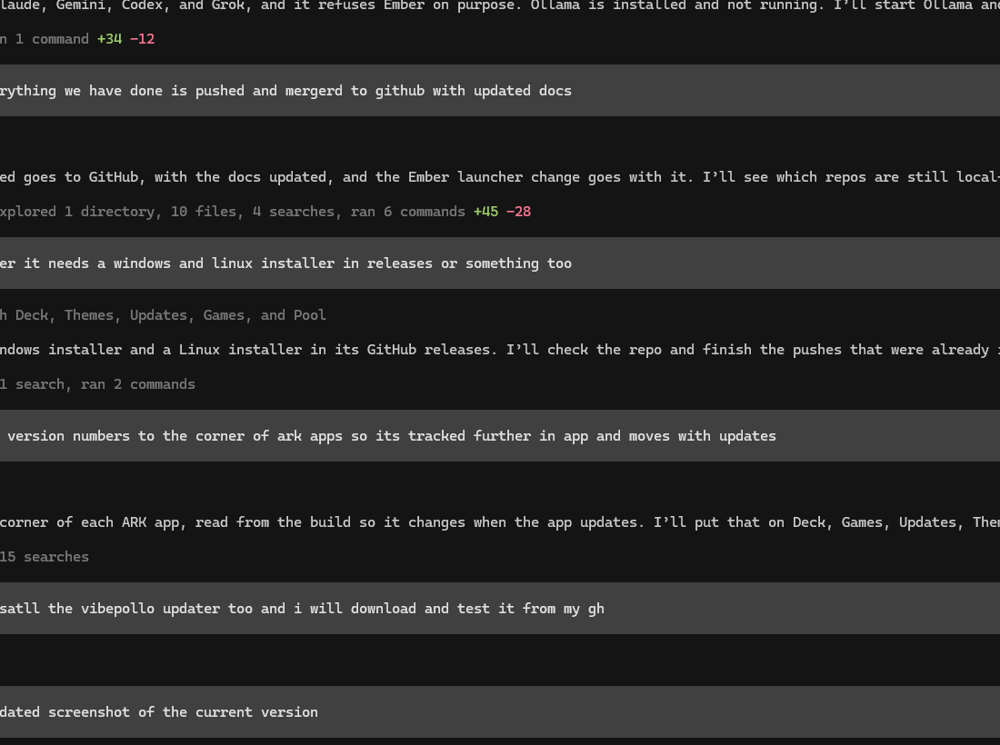

# VibePollo Updater

**A little less release hunting. A lot more streaming.**

[](https://github.com/koobie777/vibepollo-updater/actions/workflows/ci.yml)
[](https://github.com/koobie777/vibepollo-updater/actions/workflows/upstream-compatibility.yml)
[](LICENSE)

I use [VibePollo](https://github.com/Nonary/Vibepollo) on both Windows and Linux for gaming and remote desktop. I wanted a simple way to install it, try newer releases, and get back to a working version without digging through GitHub assets every time.

So I made one. This is an **unofficial, community-made installer and updater** for **Windows** and **Arch Linux**, with a desktop window if you want it and a CLI if you don't.

> **Quick heads-up:** This is not part of VibePollo, and it does not modify or replace its source code. It downloads the official installers published by the upstream project. Upstream can change how those packages work, so compatibility isn't guaranteed.

## Releases

This updater's own versions are [GitHub Releases](https://github.com/koobie777/vibepollo-updater/releases). The notes for each version are in [CHANGELOG.md](CHANGELOG.md). A version is not done until both are updated.

| Version | Date | What changed |
| --- | --- | --- |
| [1.4.0](https://github.com/koobie777/vibepollo-updater/releases/tag/v1.4.0) | 2026-11-26 | .NET 10 window (WinUI 3 on Windows, Uno Skia on Linux). Plan before install, cached rollback by name. Windows zip and Linux tar are on the release. |
| [1.3.1](https://github.com/koobie777/vibepollo-updater/releases/tag/v1.3.1) | 2026-11-24 | Darker window, no stray consoles on Windows, this changelog |
| [1.3.0](https://github.com/koobie777/vibepollo-updater/releases/tag/v1.3.0) | 2026-11-24 | Windows installer, config backup, ViGEmBus v1.22.0 |
| [1.2.0](https://github.com/koobie777/vibepollo-updater/releases/tag/v1.2.0) | 2026-11-23 | Numeric Stable/Latest channels and downgrade guard |
| [1.1.1](https://github.com/koobie777/vibepollo-updater/releases/tag/v1.1.1) | 2026-11-23 | Real launcher icon, optional Desktop icon |
| [1.1.0](https://github.com/koobie777/vibepollo-updater/releases/tag/v1.1.0) | 2026-11-23 | Every recent tag, install one tag |
| [1.0.0](https://github.com/koobie777/vibepollo-updater/releases/tag/v1.0.0) | 2026-11-23 | Arch GUI and CLI, SHA-256 check, three-package rollback |

Those tags are this project. The packages it installs still come from [Nonary/Vibepollo](https://github.com/Nonary/Vibepollo/releases).

## What it does

| | |
| --- | --- |
| **Install or update** | Pick a release and install the official Windows `VibepolloSetup.exe` or Arch `.pkg.tar.zst` package. |
| **Stable or Latest** | Stable follows upstream's non-prerelease releases; Latest follows the newest published release, including prereleases. |
| **Choose a specific version** | Browse up to the 100 most recent GitHub releases, including older builds. |
| **Roll back** | Reinstall a previously downloaded package from the local cache (up to three builds are kept). |
| **Windows config safety** | Backs up `%ProgramFiles%\Apollo\config` before running the Windows installer, warns on stacked duplicate installs, and shows `ApolloService` status. |
| **Windows ViGEmBus helper** | Detects [ViGEmBus v1.22.0](https://github.com/nefarius/ViGEmBus/releases/tag/v1.22.0) (final release, SHA-256 pinned) and installs or updates it on demand for Xbox 360 / DS4 / auto gamepad emulation. |
| **See what you're getting** | Read release notes, package details, and the SHA-256 digest before installation. |
| **Use the GUI or terminal** | WinUI 3 window on Windows (in the release zip). Python CLI on Windows and Linux. Running the script with no flags still opens the older PySide6 window when PySide6 is installed. |

Nothing installs in the background. You decide when to check for updates and when to install one.

## Get started

### Windows

Tender: download the Windows zip from [v1.4.0](https://github.com/koobie777/vibepollo-updater/releases/tag/v1.4.0). You need **Windows 10/11 (x64)** and **Python 3.10+**. The zip includes the window. The Python CLI still does the download, the SHA-256 check, and the install.



```powershell
# Unzip vibepollo-updater-1.4.0-windows.zip, then:
powershell -ExecutionPolicy Bypass -File .\install.ps1
```

Open **Vibepollo Updater** from the Start menu or Desktop, or run `vibepollo-updater --check` in a new terminal.

- Skip the Desktop shortcut: `.\install.ps1 -NoDesktop`
- Remove **this updater** (not VibePollo, the cached installers, or the config backups): `.\install.ps1 -Uninstall`

Cached Windows installers live in `%LOCALAPPDATA%\vibepollo-updater\cache\` (tagged by release version so rollback stays clear), and pre-install config backups live in `%LOCALAPPDATA%\vibepollo-updater\config-backups\`.

### Arch Linux

Mainstay: download the Linux tar from the same release, or clone the repo. You need an **x86_64 Arch-based Linux installation**, Python 3.10+, and `pacman`. Package installation uses `pkexec` or `sudo`. The 1.4.0 Linux asset installs the CLI. A `ui/vibepollo-ui` binary next to `install.sh` is installed as the window when you have built one. PySide6 is only for the older Python window.

Built around Arch Linux and EndeavourOS. Other Arch-based distributions (including CachyOS and Manjaro) may work, but haven't all been tested. SteamOS has additional system-write restrictions, so treat it as **unverified** rather than plug-and-play support.

```bash
git clone https://github.com/koobie777/vibepollo-updater.git
cd vibepollo-updater
./install.sh
```

Open **Vibepollo Updater** from your app menu, or run:

```bash
vibepollo-updater
```

The installer places the updater in `~/.local/bin`, adds an application-menu entry, and creates a Desktop shortcut if `~/Desktop` exists. To skip that shortcut, use `./install.sh --no-desktop`. There's also an optional VibePollo Desktop launcher: `./install.sh --with-vibepollo-icon`.

To remove **this updater** (not VibePollo):

```bash
./install.sh --uninstall
```

The uninstall command leaves your cached packages alone.

## Which release should I choose?

VibePollo's developer changed its release structure in November 2026. Releases now use numeric versions such as `2.x.x` across release types, rather than relying on `-stable`, `-beta`, or `-nightly` suffixes.

- **Stable:** the latest upstream GitHub release **not marked prerelease**. Upstream holds this back to allow changes to settle.
- **Latest:** the newest published release, even if GitHub marks it prerelease.
- **Specific version:** choose a particular tag from the recent release list.

**Important:** A time-gated Stable release can have a *lower version number* than the newest prerelease. Switching from Latest back to Stable may therefore be a **downgrade**. The GUI warns you, and the CLI asks for an explicit `--allow-downgrade`.

The updater reads GitHub's release metadata instead of trying to guess the channel from a filename. If upstream changes how its releases are published, we may need to adjust it.

## Terminal cheatsheet

```bash
# See the installed version, current releases, and potential downgrades
vibepollo-updater --check

# Get the same information as JSON
vibepollo-updater --json

# Install from either release selection
vibepollo-updater --update stable
vibepollo-updater --update latest

# Pick a specific release
vibepollo-updater --list
vibepollo-updater --install-version 2.20.1

# Show only non-prerelease releases
vibepollo-updater --list --stable-only

# Go back to your most recent locally cached package
vibepollo-updater --rollback

# Only if you really intend to install an older numeric version
vibepollo-updater --update stable --allow-downgrade

# Windows only: run upstream's installer silently (/qn /norestart)
vibepollo-updater --update latest --silent

# Windows only: download, verify SHA-256, and install ViGEmBus v1.22.0
vibepollo-updater --install-vigembus
```

For compatibility with older scripts, `--update prerelease` and `--update nightly` still select the newest GitHub prerelease. Their names are **legacy aliases**, not separate modern release channels.

## A few safety rails

- **Official downloads:** Looks up releases from [Nonary/Vibepollo](https://github.com/Nonary/Vibepollo) and downloads their published Windows setup `.exe` or Arch package over HTTPS.
- **Checksums before installation:** Requires a valid SHA-256 digest from GitHub release metadata and checks each downloaded file against it before running the installer or `pacman`. That checks the download against the metadata; it is **not** an independent signature or audit of upstream.
- **Local permission prompt:** On Windows, backs up `%ProgramFiles%\Apollo\config` and runs upstream's installer with one UAC prompt. On Linux, installs through `pkexec` (GUI) or `sudo` (CLI). No downloaded shell scripts are run.
- **Scoped Linux conflict handling:** On Arch Linux, can offer a narrowly targeted overwrite for VibePollo/VibeShine files confirmed to be unowned by another pacman package. No blanket `--overwrite '*'`.
- **No surprise updates:** No daemon, auto-updater, or hidden installation task.

Cached rollback packages were verified **when downloaded**. This is a convenience feature, not a substitute for a system snapshot or a full recovery plan.

### What about other Linux distros?

Right now upstream publishes a Windows installer and an Arch `x86_64` package, not `.deb`, `.rpm`, AppImage, or Flatpak builds for Linux. On other Linux distros, the updater can show release information, but **won't pretend an incompatible package is installable**.

## Keeping up with upstream

Fair question: *what happens if VibePollo changes something?*

This helper depends on upstream's release format, so breakage is possible. Here's the approach:

1. The normal [CI tests](https://github.com/koobie777/vibepollo-updater/actions/workflows/ci.yml) run on both Linux and Windows, covering parsing, version selection, checksum handling, and cache pruning without installing packages.
2. A separate [scheduled compatibility check](https://github.com/koobie777/vibepollo-updater/actions/workflows/upstream-compatibility.yml) checks **live upstream GitHub release metadata** for both Linux and Windows assets twice a week. It downloads **no packages**, changes **no machines**, and can flag release-format drift.
3. Actual installation, driver/graphics integration, and runtime behavior still need **real machine testing**. A green metadata check isn't proof that a release will work on every system.

If something breaks, open an [issue](https://github.com/koobie777/vibepollo-updater/issues) with your OS/distro, updater command/version, the VibePollo release tag, and a short error log. Please remove any private paths or tokens before posting logs.

I plan to keep using VibePollo, and I'll keep improving this little helper as I learn what people need. Suggestions and pull requests are welcome. No grand promises about every OS or every future upstream change—just a useful tool that's worth maintaining.

## For anyone who wants to tinker

```bash
python -m unittest discover -s tests -v
QT_QPA_PLATFORM=offscreen python vibepollo-updater --smoke-offscreen

# Live upstream metadata check (needs network; does not install anything)
python tests/upstream_contract.py
```

The last command is also what the scheduled compatibility workflow runs.

## Credits & license

VibePollo belongs to the [upstream project and its contributors](https://github.com/Nonary/Vibepollo). This is an **independent helper**, not an official VibePollo release or a request for upstream to maintain it.

The updater is licensed under the [MIT License](LICENSE). VibePollo is distributed under its own upstream license.

---

*Built for my streaming workflow. Shared in case it makes yours a little easier, too.*
